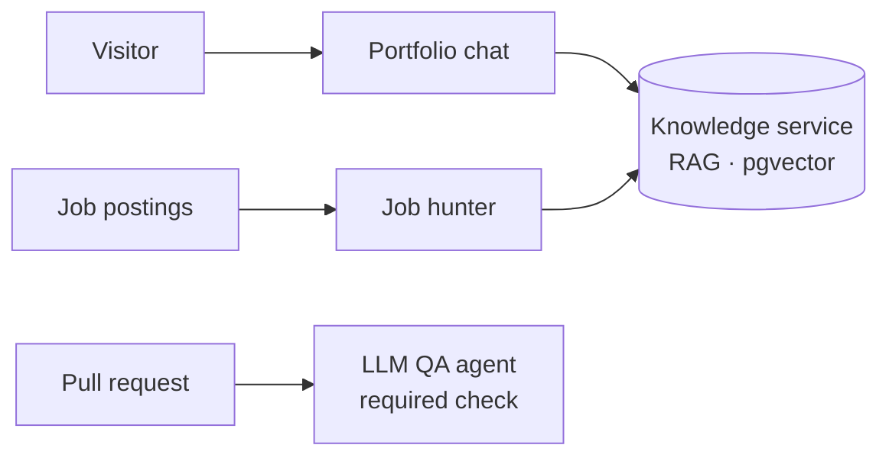

<!--
**raymanguino/raymanguino** is a ✨ _special_ ✨ repository because its `README.md` (this file) appears on your GitHub profile.

Here are some ideas to get you started:

- 🔭 I’m currently working on ...
- 🌱 I’m currently learning ...
- 👯 I’m looking to collaborate on ...
- 🤔 I’m looking for help with ...
- 💬 Ask me about ...
- 📫 How to reach me: ...
- 😄 Pronouns: ...
- ⚡ Fun fact: ...
-->
# Ray Manguino — AI API Engineer

Senior software engineer (15+ years) building APIs, distributed systems and, lately, LLM systems that run like production software.
Previously Tanium · Nacelle · Capital One · IBM. Based in Caledon, Ontario 🇨🇦

[ray-manguino.dev](https://ray-manguino.dev) · [LinkedIn](https://linkedin.com/in/raymanguino) · [ray.manguino@gmail.com](mailto:ray.manguino@gmail.com)

> 💬 **Don't read my résumé. Ask it.** [ray-manguino.dev](https://ray-manguino.dev) has a chat that answers questions about my background, using a RAG service I built.

---

### 🚀 Flagship: [six7swe](https://github.com/raymanguino/six7swe)

My own production platform: a public portfolio with AI chat, plus a private job hunter that scores postings against my background.

- **Knowledge service**: RAG on Postgres + pgvector. It powers both the portfolio chat and the job scoring.
- **LLM QA agent**: reviews every PR in GitHub Actions and posts a required status check. It fails closed, runs no PR code and is hardened against prompt injection. Findings that aren't in the diff are filtered out.
- **Agent-built codebase**: Claude Code subagents write nearly all of the code. I write the specs and review every change. About 120 merged PRs, each tied to an issue, with CI and infra as code.

**Stack:** TypeScript · Fastify · Drizzle · Zod · Postgres/pgvector · React · Railway · Supabase

### 📦 Recently shipped in six7swe

<!-- SHIPPED:START -->
<!-- SHIPPED:END -->

### 🛠️ Also building

| Repo | What it is |
|---|---|
| [claude-agentic-workflow](https://github.com/raymanguino/claude-agentic-workflow) | My Claude Code plugin: subagents for implementation, review, security audits and dependency review, plus orchestrator skills that plan epics into parallel worktrees |
| [mission-control](https://github.com/raymanguino/mission-control) | MCP-based multi-agent coordination dashboard |

### 🧰 What I work with

**Languages:** Go · TypeScript/Node.js · SQL
**Backend:** REST & GraphQL API design · event-driven architecture · Postgres · observability
**Cloud:** AWS · Kubernetes (CKAD in progress) · Azure AI (in progress)
**AI/LLM:** RAG · evals · MCP servers · prompt-injection defence · agentic dev workflows

---

Open to senior / staff roles in AI platform & API engineering. If something here is interesting, [say hi](mailto:ray.manguino@gmail.com).
